# DESIGN.md: Exchange8:SOR — Detailed Design Document

## 1. Scope & Context

Exchange8:SOR owns smart order routing for one environment: the 9-digit
strategy-code model and its phase machine, routed-order and leg facts,
the outbound venue session registry (connections, tokens, marketable
options, market slices), the banded venue-charge lookup, and routed
trade records with their amendment flow. It explicitly does **not** own:

- client protocols and sessions — Exchange8:Gateway terminates FIX/OUCH/REST
  and calls SOR with already-authorized orders; SOR authorizes nothing
  about the *client*;
- matching — the POST phase's internal target re-posts the remainder to
  Exchange8:ME through the Gateway re-post path; SOR never matches;
- venue market data — Exchange8:VFeeds feeds quotes (STAMP CBBO); SOR
  subscribes and consumes;
- order-entry rate/credit authorization — Exchange8:Risk gates the pipeline
  before SOR sees the order;
- fix protocol/codec internals — `crates/fix`, `crates/fixed`,
  `crates/stamp` own the engines SOR reuses;
- trade clearing and routed-trade mirroring — Exchange8:Clearing consumes the
  `exchange8:routing:*` events and persists its own mirror;
- event durability, audit archival, identity, TLS — platform planes
  (Sentin8:Bus, Sentin8:Sys, Sentin8:Auth, `sentin8-tls`, Shield).

### System context

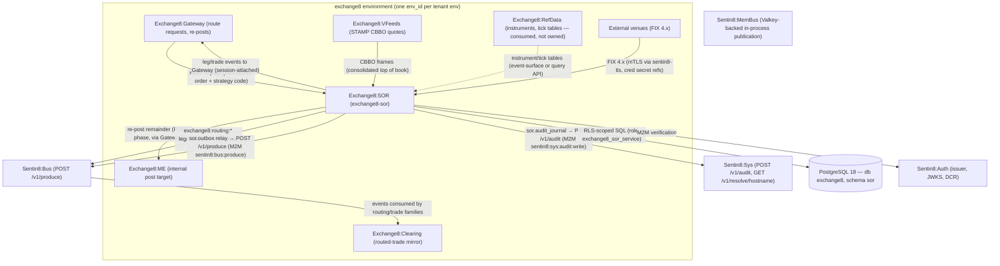

### Container view

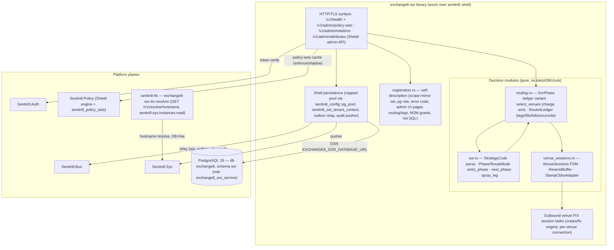

## 2. Runtime Architecture

The binary boots via `sentin8::shell::serve`:

1. `Sentin8Shell::new("exchange8:sor", "EXCHANGE8_SOR")` — registration,
   DB pool (`EXCHANGE8_SOR_DATABASE_URL`), `/v1/health`, mimalloc global
   allocator, graceful drain under `make upgrade-instance`.
2. `with_simple_state()` — the shell's standard state handle; outbound
   venue FIX sessions run as **dedicated tasks** (the HTTP router carries
   health and admin endpoints only), driven by the `crates/fix` session
   engine under `VenueSessions` supervision.
3. `with_router(extend_router)` mounts `/v1/health` (shell) and the
   shared Shield policy-admin API (`/v1/admin/policy-sets*`,
   `/v1/admin/relations*`, `/v1/admin/attributes*`) through
   `HasPolicyAdmin` — admin and request path share one policy cache.
4. `registration::print` serves `--print-registration`: the
   `scope-mirror` Shield set (action `exchange8:sor:decide` over the live
   effective scope set of `exchange8:routing:read`/`exchange8:routing:write`,
   plus `sentin8:sys:admin`/sys-org/env-admin permits), the
   `exchange8_sor_service` PostgreSQL role (database `exchange8`, no
   BYPASSRLS, no cross-schema grants), the single error code
   `exchange8_strategy_code_invalid` (HTTP 422), the RFW admin pages
   (`routing`, `legs`), M2M workloads, and the `init` SQL for the `sor`
   schema.

### Component diagram

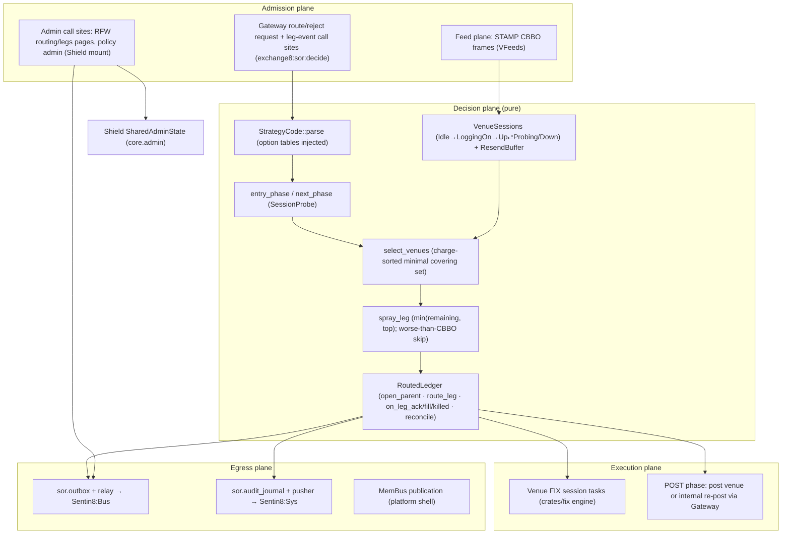

### Request lifecycle — order routing decision

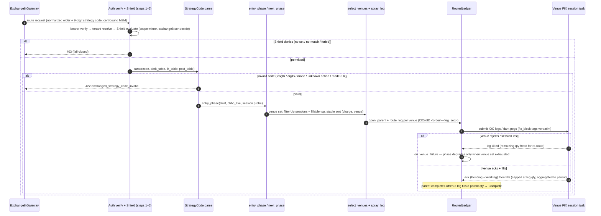

### Request lifecycle — venue session lifecycle

```mermaid
sequenceDiagram
    autonumber
    participant T as Session supervisor (task)
    participant VS as VenueSessions FSM
    participant FIX as crates/fix session engine
    participant V as Venue

    T->>FIX: connect (per routing_connection row: comp ids, addr, port, heartbeat)
    FIX-->>VS: Connect event (Idle → LoggingOn)
    alt logon accepted
        FIX-->>VS: LogonAccepted (LoggingOn → Up; routable)
    else logon rejected
        FIX-->>VS: LogonRejected (→ Down; reconnect loop re-enters)
    end
    loop while Up
        FIX-->>VS: Heartbeat (stays Up)
        FIX-->>VS: HeartbeatTimeout (Up → Probing; TestRequest in flight)
        alt TestRequestOk
            FIX-->>VS: TestRequestOk (Probing → Up)
        else probe fails / disconnect
            FIX-->>VS: HeartbeatTimeout or Disconnect (→ Down)
        end
    end
    Note over VS: duplicate events are idempotent no-ops; unknown venues are never routable
    Note over FIX: ResendBuffer replays unacked outbound messages in order on reconnect
```

### Request lifecycle — fill handling and proceeds to clearing

```mermaid
sequenceDiagram
    autonumber
    participant V as Venue (FIX execution report)
    participant FS as Session task (echo dedup)
    participant RL as RoutedLedger
    participant OB as sor.outbox + relay
    participant BUS as Sentin8:Bus
    participant CLR as Exchange8:Clearing

    V->>FS: execution report (trade, qty, price, liquidity A/R)
    FS->>RL: on_leg_fill(leg_id, qty)
    alt qty > leg remainder (drop-detect over-echo)
        RL-->>RL: credit min(qty, leg remaining); leg completes at true size
    end
    RL->>RL: aggregate leg fill into parent (Complete at ≥ parent qty)
    RL->>OB: same-tx INSERT routing_trade row + outbox event (exchange8:routing trade family)
    OB->>BUS: POST /v1/produce (M2M sentin8:bus:produce, idempotency_key = outbox row id)
    BUS-->>CLR: stream delivery (consumer group)
    CLR->>CLR: persist routed-trade mirror (+ amend flow on amendments)
```

### Request lifecycle — admin (RFW)

```mermaid
sequenceDiagram
    autonumber
    participant UI as Admin (Sentin8:Dash → Sentin8:BFF)
    participant SOR as Exchange8:SOR admin routes
    participant SH as Shield cache (SharedAdminState)
    participant DBX as sor schema + sor.outbox / sor.audit_journal

    UI->>SOR: admin surface (RFW page routing/legs; delegated bearer user token)
    SOR->>SH: Shield evaluate (scope-mirror; tenant forbid wins)
    alt denied
        SOR-->>UI: 403 (fail-closed)
    else allowed
        SOR->>DBX: read/copy routing configuration or routed-order facts (RLS-scoped, same-connection context)
        SOR->>DBX: mutation + same-tx outbox/journal rows (configuration changes)
        DBX-->>DBX: pg_notify sor_outbox_changed → relay; audit pusher → Sys
        SOR-->>UI: page payload (rendered by the RFW renderer)
    end
```

## 3. Data Model

Schema `sor` in database `exchange8` (database-per-vertical,
schema-per-service); role `exchange8_sor_service` holds exactly the
grants in `init.sql` (`search_path = sor, public`; no BYPASSRLS, no
cross-schema grants — this service owns all its reads). RLS is FORCEd on
every table with `sentin8_context_initialized() AND env_id =
sentin8_current_env_id()` policies; context is set per connection via
`SELECT sentin8_set_tenant_context($1)` — always awaited,
transaction-local (`set_config(..., true)`) on the same connection as the
query.

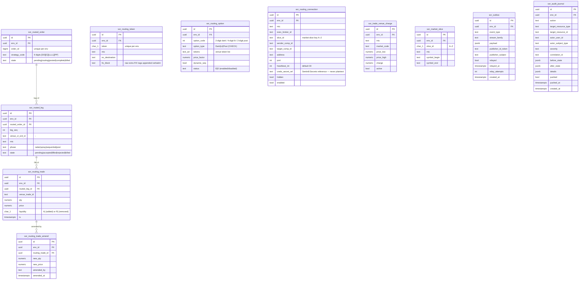

Per-table notes:

- `sor.routing_token` — token→venue mapping (the strategy code's option
  tables resolve to these tokens). UNIQUE `(env_id, token)`. Env-scoped;
  no secret-bearing columns (`fix_block` is non-sensitive routing tags).
- `sor.routing_option` — marketable option codes: `option_type` is
  CHECK-enforced to `Dark|Lit|Post`; `tokens` carries the venue token
  list; `price_factor` and `dynamic_seq` configure charge/sequence
  behavior; `status` is `E`/`D`. UNIQUE `(env_id, option_code,
  option_type)`.
- `sor.routing_connection` — outbound session definition per MIC ×
  broker × symbol-slice; session pick is
  `find(mic, broker, slice(symbol[0]))`. Credentials ride
  `creds_secret_ref` (a Sentin8:Secrets reference — never plaintext);
  `heartbeat_int` drives the supervisor's heartbeat window.
- `sor.routed_order` — parent facts: order id, strategy code, state.
  UNIQUE `(env_id, order_id)`.
- `sor.routed_leg` — child facts: `venue_cl_ord_id` (`<platform_order_id>-
  <leg_seq>`), MIC, phase, state, UNIQUE `(routed_order_id, leg_seq)`.
  The in-memory `RoutedLedger` is the working set; these tables are the
  rebuild source (crash recovery).
- `sor.routing_trade` / `sor.routing_trade_amend` — venue fill facts
  (`venue_trade_id`, `qty`, `price`, `liquidity A|R`) and their amendment
  trail (`new_qty`, `new_price`, `amended_by`). `liquidity` is
  CHECK-enforced to `A`/`R`. Clearing mirrors these through the
  `exchange8:routing` events, never by table access.
- `sor.trade_venue_charge` — banded routing charge per MIC × market ×
  price band (`price_low`..`price_high`, `active`). The cheapest-first
  sort's input.
- `sor.market_slice` — symbol-letter venue slices (`slice_id` A–Z,
  `symbol_begin`..`symbol_end`), UNIQUE `(env_id, slice_id, mic)`.
- `sor.outbox` — the local outbox (platform `sentin8_outbox` shape): rows
  inserted in the same transaction as the domain change (`event_type`,
  `stream_family`, `payload`), `relayed`/`relayed_at`/`relay_attempts`
  maintained by the shell relay, partial index on unrelayed rows, and
  `outbox_notify_trigger` firing `pg_notify('sor_outbox_changed')` for
  relay wake-up.
- `sor.audit_journal` — the local audit journal (platform `sentin8_audit`
  shape): admin/domain actions with before/after states, actor/subject/
  severity/correlation; `pushed`/`pushed_at` track delivery to Sys;
  partial index on unpushed rows.
- In-memory only: the `RoutedLedger` working set and the
  `VenueSessions`/`ResendBuffer` states — both restorable from the
  durable tables plus venue sequence resets (reconciliation, §6).

### Routed-order lifecycle (ledger view)

```mermaid
stateDiagram-v2
    [*] --> Pending: route_leg (open_parent first; unknown parent rejected)
    Pending --> Working: venue ack (on_leg_ack)
    Pending --> Killed: venue reject / loss before ack
    Working --> Filled: Σ fills ≥ leg qty (capped at leg qty)
    Working --> Killed: venue kill/cancel — remaining qty freed for re-route
    Filled --> [*]: parent Complete when parent Σ fills ≥ parent qty
    Killed --> [*]: no-op if leg already Filled (no-op guard)
```

### SorPhase lifecycle (ledger view with failure transitions)

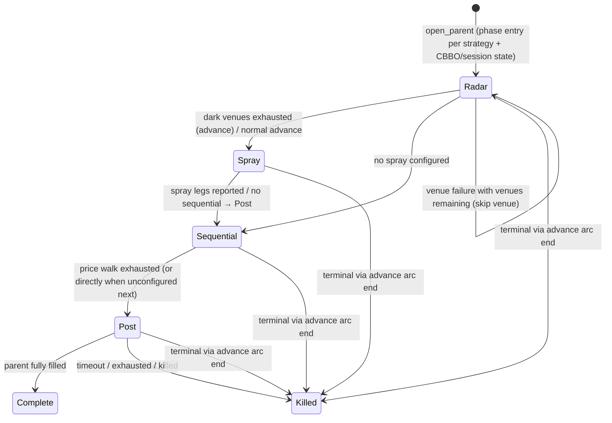

## 4. API Surface

| Audience | Surface | Gate | Notes |
|---|---|---|---|
| Upstream services (M2M) | route request / reject request / leg events streams | bearer verify → tenant resolve → Shield (`exchange8:sor:decide` over the mirror of `exchange8:routing:read`, `exchange8:routing:write`; also `sentin8:sys:admin`, sys org/env admins) | internal streams per the design's API surface (open mounting, §10) |
| Admin / Shield | `GET/PUT/DELETE /v1/admin/policy-sets{,/{name},/{name}/test}`, `POST /v1/admin/policy-sets/{enforce,shadow,disable}`, `GET/PUT/DELETE /v1/admin/relations{,/check}`, `GET/PUT/DELETE /v1/admin/attributes` | `exchange8:sor:policy:read` / `exchange8:sor:policy:write` (scope mirror also covers `sentin8:sys:admin`, sys org/env admins) | shared Shield admin API mount (wired in `extend_router`) |
| Admin (declared) | `GET /v1/admin/ui/routing` + `/v1/admin/routing`; `GET /v1/admin/ui/legs` + `/v1/admin/legs` | role `exchange8:sor:admin` (admin scopes: `exchange8:routing:read`, `exchange8:routing:write`, `exchange8:sor:policy:{read,write}`) | RFW pages `routing` (icon `0xe8d2`), `legs` (icon `0xe5d9`) |
| Health | `GET /v1/health` | unauthenticated (shell) | liveness for Sentin8:Captain |
| Error contract | `exchange8_strategy_code_invalid` | — | HTTP 422; the only declared error code |
| Out | Bus `POST /v1/produce` | M2M `sentin8:bus:produce` + `sentin8:bus:consume` | workloads `exchange8:sor`/`sor`; plus `sentin8:stat:measure` |
| Out | Sys `POST /v1/audit` | M2M `sentin8:sys:audit:write` | workload `sor-audit` |
| TLS | `GET /v1/resolve/hostname` (Sys owner API) | M2M `sentin8:sys:instances:read` | workload `exchange8-sor-tls` (database-free resolve) |

Emitted events use the `exchange8:{service}:{resource}:{operation}`
vocabulary (colons only): the `exchange8:routing:*` leg/trade routing
event family and routed-order lifecycle facts (per-change `event_type`
mapping into `sor.outbox` — see §10 for the writer surface). Inbound:
route/reject requests and leg events from Exchange8:Gateway, quotes from the
STAMP CBBO feed (VFeeds), posted-order completions re-entering from the
Gateway re-post path, and Shield policy-set updates via the shared
policy consumer. The clearing-side mirror events consumed by Exchange8:Clearing
are declared in the vertical's event registry.

### Multi-party: client → sor → me/gateway → clearing

```mermaid
sequenceDiagram
    autonumber
    participant MP as Market participant (FIX/OUCH/REST)
    participant GWY as Exchange8:Gateway
    participant SORS as Exchange8:SOR
    participant VEN as External venue (FIX)
    participant MES as Exchange8:ME (internal post)
    participant BUSX as Sentin8:Bus
    participant CLRS as Exchange8:Clearing

    MP->>GWY: parent order (session-authenticated)
    GWY->>SORS: route request (order + strategy code, M2M exchange8:sor:decide)
    SORS->>SORS: parse code · entry phase · charge-sorted venue set
    alt phase targets external venue
        SORS->>VEN: NewOrderSingle (IOC/post flags, fix_block tags, ClOrdID <order>-<leg>)
        alt venue accepts + fills
            VEN-->>SORS: ack + execution report
            SORS-->>GWY: leg accepted/filled events
            SORS->>BUSX: routing trade event (sor.outbox relay, idempotent on row id)
            BUSX-->>CLRS: routed trade → Clearing mirror (+ amend trail)
        else venue rejects / session lost
            VEN-->>SORS: reject / disconnect
            SORS->>SORS: kill leg (remaining freed) — skip venue, degrade phase only on exhaustion
            SORS-->>GWY: leg rejected/killed with reason
        end
    else remainder posted internally
        SORS->>GWY: re-post remainder (POST phase, internal target)
        GWY->>MES: posted order (re-validated; reject-on-pending-cancel kept)
        MES-->>GWY: posted-order lifecycle events
        GWY-->>SORS: leg events (new gw leg id; Reposted)
    end
    MP->>GWY: cancel (client cancel via Gateway)
    GWY->>SORS: cancel propagation
    SORS->>VEN: cancel outstanding legs (sync)
    SORS-->>GWY: remainder handling per legacy semantics
```

### Event flow: outbox → Bus → trigger

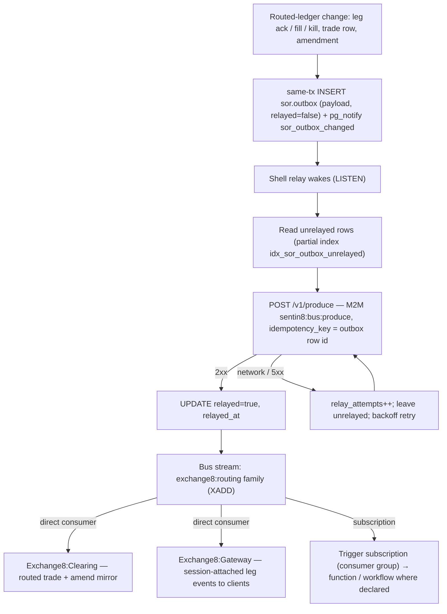

## 5. Cross-Cutting Concerns

- **Authentication.** Sentin8:Auth is the only issuer. The Gateway and
  the admin surface present cert-bound tokens; the 8-step pipeline
  applies (bearer verify → tenant resolve → feature gate → Shield
  authorize → RLS context → execute → audit); requests that cannot
  resolve a tenant context are rejected, never defaulted.
- **RLS context.** Every tenant-table access sets context on the *same*
  connection: `SELECT sentin8_set_tenant_context($1)` awaited,
  transaction-local; explicit `env_id` WHERE clauses remain
  defense-in-depth on top of FORCE RLS. The integration matrix (§9)
  proves silent zero-row reads without context, insert rejection via
  WITH CHECK, own-env visibility, and cross-env invisibility.
- **Shield authorization.** Step 5 is the only gate. The seeded
  `scope-mirror` set (declared in `registration.rs` as
  `SCOPE_MIRROR_POLICIES`, asserted by tests) is action-granular over the
  live effective scope set for `exchange8:sor:decide`; enforce mode
  decides, shadow logs would-deny without blocking; tenant-authored
  forbid beats the platform mirror; M2M parity holds (`token_tp` never
  bypasses); no-set / no-match deny (fail-closed). The wiring tests
  assert the declared set covers every handler action and passes the
  enroll-time dry-run.
- **Idempotency & exactly-once.** Bus delivery is at-least-once by
  stream semantics; the outbox relay's `idempotency_key = sor.outbox.id`
  makes produce effectively-once per domain event. Fill credit is
  capped at the leg remainder, so replayed venue echoes cannot
  over-aggregate the parent ledger.
- **Rate limiting / bot protection.** This service routes already
  authorized flow; per-connection throttling belongs upstream
  (Exchange8:Gateway/Exchange8:Risk). The service's own surfaces rely on
  platform-level protections (Shield + BFF posture); no bespoke rate
  limiter is mounted here.
- **Audit journaling.** Domain/admin changes ride `sor.audit_journal`
  (same transaction where applicable) with actor/subject/severity/
  correlation; the shell pusher forwards unpushed rows to
  Sys `POST /v1/audit` (workload `sor-audit`, scope
  `sentin8:sys:audit:write`); a Sys outage only delays delivery, never
  loses records.
- **Drain.** `sentin8::shell` graceful drain integrates with
  `make upgrade-instance`: the replacement instance reaches `Active`
  before the old drains in-flight routing work and flushes outstanding
  outbox/journal rows — venue sessions and per-order tasks stop on the
  drained instance, and the recovery paths (§6) absorb the boundary.
- **TLS posture.** In-process TLS via `sentin8-tls` (post-quantum
  X25519MLKEM768 / ML-DSA-65) for both the platform surface and outbound
  venue FIX (mTLS; logon credentials as secret refs, per-connection
  submission audit). The DB-free resolver workload `exchange8-sor-tls`
  resolves hostnames through the Sys owner API
  (`GET /v1/resolve/hostname`, scope `sentin8:sys:instances:read`) — no
  platform-database DSN for resolution, no BYPASSRLS anywhere in the
  grant set.

## 6. Failure Modes & Recovery

**Skip-and-continue posture.** A venue that cannot route is skipped, not
fatal: selection proceeds on the remaining up venues, and the phase
degrades only when its venue set is exhausted. A strategy code that
cannot parse is rejected before any leg exists. Unknown venues,
malformed feed frames, and duplicate session events degrade — never
panic, never silently route.

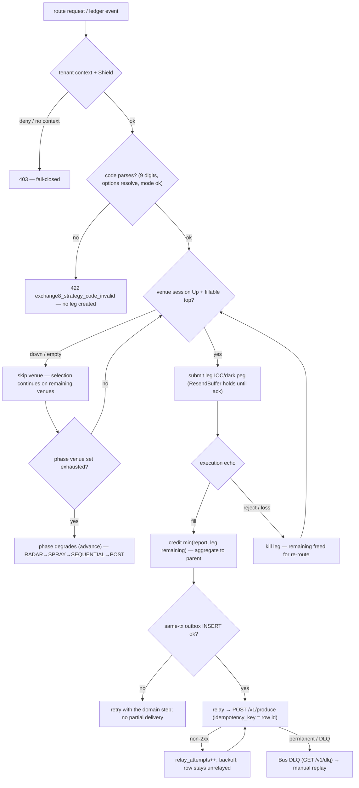

- **Venue session loss.** Session `Down` means the venue is not a
  candidate: routing continues on remaining venues; RADAR/SEQUENTIAL
  mark the venue unavailable for the order pass. Reconnect re-enters
  `LoggingOn`; the ResendBuffer replays unacked outbound messages in
  order, and venue sequence resets are an admin operation on
  `routing_connection`.
- **Venue fill echo lost.** Drop-detect dedup per session plus venue
  resend on reconnect (ResendBuffer). Over-reported or duplicated echoes
  credit at most the leg remainder — the parent aggregate converges to
  the leg's true quantity.
- **SOR instance crash.** Routed orders rebuild from
  `sor.routed_order`/`sor.routed_leg` (the ledger is the working set);
  `reconcile()` surfaces unacked legs — the recovery
  cancel-sweep set — and orphaned legs (legs whose parent is missing) as
  explicit anomaly views. Incomplete legs are reconciled by a venue
  cancel sweep; orphans fail closed to operations review.
- **Quote staleness.** Phases requiring the CBBO (RADAR entry, SPRAY
  entry/sizing) pause the order until a fresh quote or timeout kill;
  SEQUENTIAL price-walks without an initial CBBO. The STAMP adapter
  tolerates malformed frames (skip, never inject).
- **Outbox relay outage.** `sor.outbox` rows accumulate unrelayed
  (`relay_attempts` grows); the partial index replays them in
  `created_at` order when the Bus recovers; `idempotency_key = row id`
  makes replay safe; failed deliveries land in the DLQ for manual
  replay — never silently dropped.
- **Sys audit outage.** `sor.audit_journal` rows stay unpushed; the
  pusher retries — audit is delayed, never lost.

Recovery sequence (instance start after a drained predecessor):

```mermaid
sequenceDiagram
    autonumber
    participant OPS as Operator (make upgrade-instance)
    participant SHELL as sentin8-shell boot
    participant DBX as db exchange8, schema sor
    participant LED as RoutedLedger / VenueSessions / ResendBuffer
    participant BUSE as Sentin8:Bus

    OPS->>SHELL: start (predecessor drained; sessions handed off per venue connection state)
    SHELL->>DBX: load routing_token / routing_option / routing_connection / market_slice / trade_venue_charge
    SHELL->>DBX: rebuild working set from routed_order / routed_leg (+ trades)
    DBX-->>LED: ledger restored (states per table CHECK vocabulary)
    LED->>LED: reconcile() → unacked legs (cancel-sweep set) + orphaned legs (anomaly review)
    SHELL->>VEN: reconnect sessions (Idle→LoggingOn→Up) ; ResendBuffer replays unacked in order
    SHELL->>DBX: reset relay: unrelayed sor.outbox rows
    SHELL->>BUSE: POST /v1/produce (idempotency_key = row id; no duplicate delivery)
    SHELL-->>OPS: ready (health Active in captain registry)
```

## 7. Concurrency & Performance Model

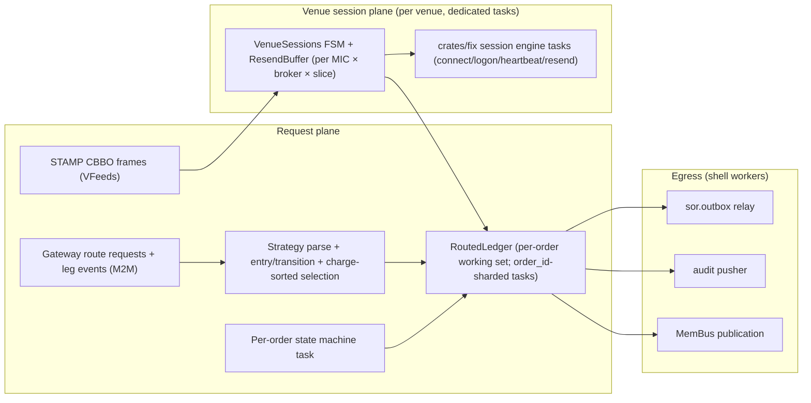

- **Task layout.** Per-order routing tasks (sharded `order_id % N`,
  the same pattern as ME/OMS) own the ledger working set for their
  orders; one dedicated task per outbound venue session runs the
  `crates/fix` engine against the supervised FSM; the shell's standard
  workers (outbox relay, audit pusher, MemBus handle) run alongside.
  No tokio, DB, or clock dependencies in the decision modules.
- **Hot path budget.** Target leg latency: < 500 µs decision + venue
  RTT (per the vertical's sizing: 5k routed orders/day/env, max 200 live
  venue sessions). The in-process work per decision is parsing a
  9-digit code, one filter+stable-sort over venue candidates, and ledger
  arithmetic on `i128`/`u64` fixed-point quantities.
- **Locking strategy.** The decision modules are single-owner: session
  states and buffers are plain `HashMap`s owned by their driver task;
  no shared mutable state crosses task boundaries. Determinism is
  preserved by the stable `(charge, venue)` sort.
- **Fixed-point math.** Prices and quantities stay in platform
  fixed-point (`exchange8::fixed::Qty`, raw `i128`/`u64`); fills clamp
  with `saturating_sub`/`min`; no floating point enters the ledger.
- **Backpressure.** Egress (outbox/audit/MemBus) is asynchronous and
  retried; routing work never queues behind egress. Venue submissions
  bound the in-flight set per session via the ResendBuffer's ack-clearing
  cycle.

## 8. Invariants, Insecure-Defaults Rejected, Unsafe Rationale

Always-true conditions:

1. A leg never exists without an open parent (`route_leg` rejects
   unknown parents); the orphan reconciliation view is therefore always
   an anomaly, never normal state.
2. Fill credit is capped at the leg remainder: the parent aggregate can
   never exceed the ordered parent quantity, whatever venues echo.
3. Killing a filled leg is a no-op; killed legs release only their
   unfilled remainder for re-routing.
4. Only `Up` sessions route; unknown venues read as `Down` and never
   route. Phase degrades only when the phase's venue set is exhausted.
5. The phase arc only advances (RADAR → SPRAY → SEQUENTIAL → POST;
   ledger terminals `Complete`/`Killed`); no backward transitions.
6. Strategy codes are totally validated before routing: exactly 9
   digits, all three option codes resolve, mode digit `0–3`, and mode 0
   carries an empty lit list — invalid codes leave no legs.
7. Identical inputs (candidates, quantity) produce identical leg plans —
   the `(charge, venue)` stable sort is deterministic across runs.
8. Outbox rows are inserted in the same transaction as the domain
   change; delivery is idempotent per row id; audit rows are delivered
   at least once to Sys.
9. No tenant-table access without tenant context on the same
   connection; RLS FORCEd on all ten tables; role
   `exchange8_sor_service` carries no BYPASSRLS, no cross-database
   grants, no cross-schema grants.
10. Shield's step-5 decision is the only authorization gate: the seeded
    scope mirror covers `exchange8:sor:decide`; shadow never blocks;
    forbid beats permit; M2M tokens never bypass policy.
11. Venue credentials are secret references only
    (`routing_connection.creds_secret_ref`); no plaintext logon
    material is stored in the schema.

Insecure-defaults rejected: no plaintext FIX logon credentials in
`sor.*` tables; no `danger_accept_invalid_certs`-style TLS shortcuts
(Sentin8:Acme root via OS trust store; mTLS for venue links); no
BYPASSRLS or superuser runtime role; no fail-open route when session
probe or quote state is unknown; no unbounded resend buffers without
ack-clearing semantics; no migration path for old strategy encodings
(the 9-digit code with a 4-digit lit option is the only grammar).

Unsafe rationale: the decision modules contain no `unsafe`; all
arithmetic is checked/saturating fixed-point over `i128`/`u64` and the
session/buffer maps are plain owned structures, so memory safety and
determinism are enforced by the type system.

## 9. Testing Strategy

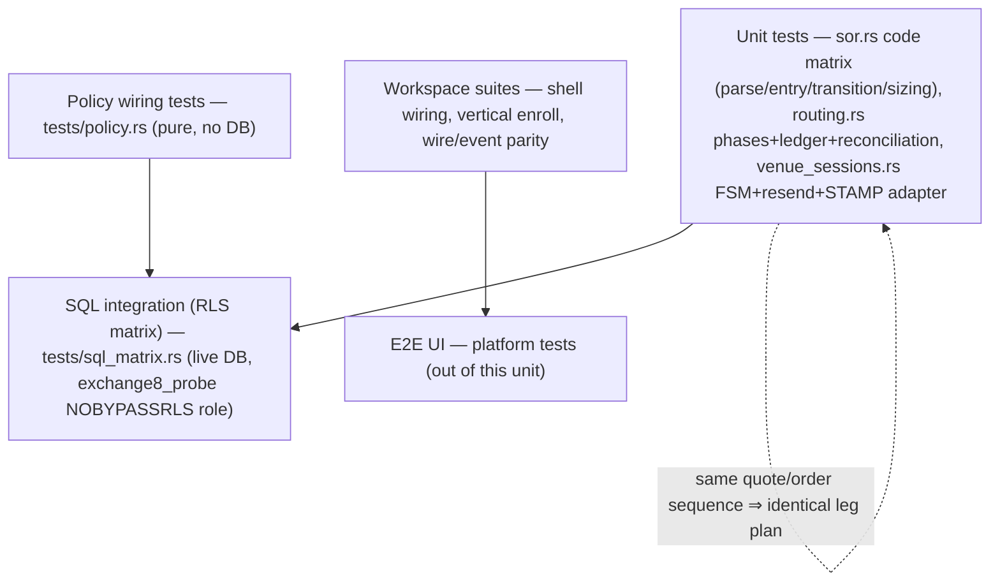

- **Strategy-code matrix** (in-module, `sor.rs`): all nine positions
  parsed, length/digit/mode/unknown-option/lit-mode-0 rejections,
  entry-rules (post-only, dark+CBBO, dark session down, sequential
  without CBBO), forward-only transitions across mixed modes, POST
  terminality, and spray sizing/skipping (at-CBBO, worse-than-CBBO, no
  quote, zero top, remaining smaller than top, sell side).
- **Phase/ledger unit tests** (in-module, `routing.rs`): phase arc with
  venue-failure degradation, charge-sorted selection (down-sessions and
  empty-tops excluded, tie-break by venue id, minimal covering set),
  ledger route/ack/fill/kill flows, parent completion, overfill capping
  (drop-detect), killed-leg remainder release, unknown-parent rejection,
  and reconciliation of unacked/orphaned legs.
- **Venue session unit tests** (in-module, `venue_sessions.rs`): full
  FSM lifecycle (cold start → logon → heartbeat → probe → down →
  reconnect), logon rejection, unknown venue never routable, duplicate
  event idempotence, resend hold/ack/replay in order, STAMP CBBO frame
  parsing (malformed skip, zero-side handling).
- **Policy wiring tests** (`tests/policy.rs`, no DB): the *actual*
  seeded `SCOPE_MIRROR_POLICIES` text loads the engine — no-set deny,
  enforced no-match deny, shadow never blocks (would-deny reported),
  mirror permits its own grants, M2M parity, platform-admin scopes pass,
  forbid-beats-permit, role-keyed tenant sets decide, cross-env set
  isolation, declared-mirror-covers-every-handler-action, and the
  enroll-time dry-run gate accepts the declared set.
- **SQL integration matrix** (`tests/sql_matrix.rs`, live PostgreSQL 18
  as the `exchange8_probe` NOBYPASSRLS role): every table declared in
  this service's `init.sql` exists with FORCE RLS + policies; zero rows
  without context; insert without context rejected (savepoint-guarded);
  own-env probe row visible exactly once; cross-env zero rows — one
  rolled-back transaction (zero residue; skips silently offline).
- **Deliberately not tested here:** venue simulators / FIX-mock fill and
  reject drills (the vertical's venue-simulator suites once the FIX
  drive is wired), platform token-verification internals, MemBus/Bus/Sys
  wire formats, RFW rendering, and Flutter surfaces — platform-owned
  suites (the platform testing strategy doc); E2E UI lives at platform
  level.

## 10. Open Questions

- Route-request ingestion and leg-event egress: the Gateway ⇄ SOR
  streams (route/reject requests, leg events, quote subscription) are
  the designed surface; the handler/event wiring into this binary's
  router and event trigger bindings (`event_triggers` is declared
  empty) is the open integration point.
- The FIX session drive: connecting `VenueSessions`/`ResendBuffer` to
  live connections via the `crates/fix` engine (connect loop, logon
  dispatch, resend replay, per-session echo dedup) is designed (per-
  venue dedicated tasks) but not yet wired in this binary.
- Per-change `event_type` strings written into `sor.outbox` for the
  routed order/leg/trade lifecycle (the `exchange8:routing:*` family);
  the schema and relay are in place, the writer is remaining work.
- Declared admin handlers for the RFW pages `/v1/admin/ui/routing` +
  `/v1/admin/ui/legs` (data endpoints `/v1/admin/routing`,
  `/v1/admin/legs`), session-management controls (enable/disable
  connection, sequence reset, logout) and the routed-order blotter with
  leg drill-in: shapes declared at enrollment, handlers pending.
- Dynamic-charge fallback tiers (beyond the banded
  `trade_venue_charge` lookup, the `BCMP`-parity dynamic book-charge
  tier) and `price_factor` application in the charge lookup.
- Multi-instance sharding details (per-order task sharding
  `order_id % N` and its partition assignment on instance start) and
  the full rebuild/restore procedure across instances.

---

**Design attribution:** exchange8:sor and its underlying concepts were designed by Hamid Jahanzad <Hamid@Jahanzad.com>.
