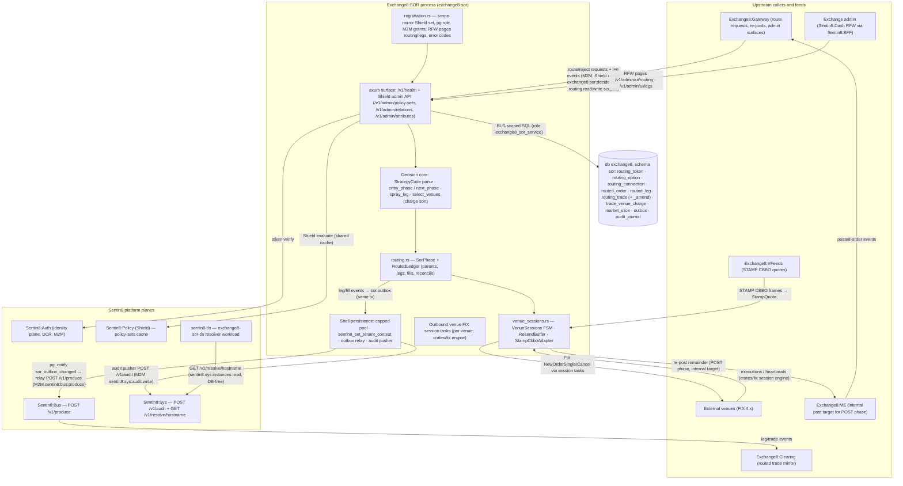

# README.md: Exchange8:SOR

## 1. Summary

Exchange8:SOR (service type `exchange8:sor`, binary `exchange8-sor`) is the
**smart order router** of the exchange8 vertical — the capital-markets
tier of the Sentin8 platform. It routes orders to external venues and
home again: it consumes routing requests from Exchange8:Gateway, interprets the
**9-digit strategy code** (`[DD][C][LLLL][PP]` — dark option, mode
selector, lit option, post option), walks venue liquidity through the
phase arc **RADAR → SPRAY → SEQUENTIAL → POST** (dark midpoint pegs, a
parallel IOC sweep priced at the consolidated best bid/offer, a one-venue-
at-a-time price walk toward the limit, then a resting remainder posted to
the post venue or back to Exchange8:ME), and reconciles venue executions back
to platform orders through the routed-order ledger. Venue ordering is
charge-driven: a stable, charge-sorted selection (ties broken by venue id)
picks the cheapest venues first. Outbound venue sessions are supervised
FIX 4.x links (logon, heartbeat, test-request probes, resend buffers);
quotes arrive as TSX **STAMP CBBO** frames normalized to consolidated
top-of-book events.

The service core is a set of pure, deterministic modules — the strategy
code parser (`sor.rs`), the phase machine and routed-order ledger
(`routing.rs`), and the venue session supervisor + feed adapter
(`venue_sessions.rs`) — wrapped in the shared Sentin8 platform shell
(`sentin8::shell`): axum HTTP/TLS surface, `--print-registration`
self-description, DB pool, `/v1/health`, the Shield (declarative-policy)
admin API mount, mimalloc global allocator, and graceful drain. Event
egress is the platform trio: in-process MemBus publication, the local
`sor.outbox` relayed to Sentin8:Bus, and the `sor.audit_journal` pushed
to Sentin8:Sys. Persistence is database `exchange8`, schema `sor`, role
`exchange8_sor_service` (no BYPASSRLS), DSN `EXCHANGE8_SOR_DATABASE_URL`.

## 2. Motivation

- **One order, many venues, one ledger.** Participants think in parent
  orders; venues see independent child legs. The routed-order ledger
  binds parents to legs across the whole phase arc — fills aggregate
  upward, kills free quantity downward, and every leg is traceable to its
  parent under audit.
- **Best-price-plus-cost routing.** Venue selection is a deterministic,
  charge-sorted choice over live session state: only venues with an up
  session and fillable top-of-book participate, cheapest first, and the
  fan-out set is the minimal list that covers the requested quantity.
- **Phased liquidity capture without guesswork.** The strategy code is a
  compact, validation-gated encoding of a full execution policy: dark
  access, spray breadth, sequential price walking, and post behavior.
  Validation is total — a code that does not parse never routes
  (`exchange8_strategy_code_invalid`, HTTP 422).
- **Sessions are first-class routing inputs.** A venue whose session is
  not `Up` is not a venue: the router skips it and continues on the
  remaining venues, and the session supervisor owns the state machine
  (logon, heartbeat, probe, reconnect) plus the resend buffer that keeps
  outbound FIX sequences honest across reconnects.
- **Reconciliation as a first-class capability.** Legs that lost their
  ack, fills echoed after a drop, and legs whose parent vanished are
  surfaced by reconciliation views (`reconcile()` → unacked / orphaned),
  not discovered in a morning-after reconciliation meeting.
- **No bespoke infrastructure.** Identity, TLS, declarative policy,
  durable events, and audit delivery are platform planes (Sentin8:Auth,
  `sentin8-tls`, Shield, Sentin8:Bus, Sentin8:Sys); the binary owns only
  the routing domain.

## 3. Architecture & High-Level Design

The service is one binary in three layers: the pure decision modules
(`sor.rs` strategy/phase/entry/sizing, `routing.rs` phase ledger + leg
reconciliation, `venue_sessions.rs` session FSM + resend buffer + STAMP
adapter), the shell wiring (`main.rs` mounts health + the shared Shield
policy-admin API; outbound venue FIX sessions run as dedicated tasks, and
the HTTP router carries health and admin endpoints only), and the data
plane (`sql/init.sql` — schema `sor` on database `exchange8`).

The shell boots registration, the DB pool (`EXCHANGE8_SOR_DATABASE_URL`),
and the router: `/v1/health` (shell) plus the shared Shield policy-admin
mount over `HasPolicyAdmin`, so admin and request path share one policy
cache. The decision modules are deliberately I/O-free: `sor.rs` parses
and gates the strategy code and computes phase entry/transition/sizing
against injected probes (`SessionProbe`, option tables); `routing.rs`
keeps the routed-order ledger and its reconciliation views;
`venue_sessions.rs` holds the per-venue session states, the resend
buffers, and the STAMP CBBO adapter. The broker-less FIX engine lives in
`crates/fix` and drives the sessions the supervisor tracks.

## 4. Key Traits and Data Structures

- **`StrategyCode` (strategy encoding).** A 9-digit ASCII string
  `[DD][C][LLLL][PP]`: dark-option code (digits 1–2), mode selector
  (digit 3: `0` none · `1` spray · `2` sequential · `3` spray+sequential),
  lit-option code (digits 4–7), post-option code (digits 8–9). Parsing
  resolves each option code against caller-supplied token tables and
  fails on unknown codes, wrong length, non-digits, a mode digit outside
  `0–3`, or a non-empty lit list under mode `0`. A post option of `0`
  means "no post venue" (internal re-post only).
- **Phase machine (`Phase`, `entry_phase`, `next_phase`, `spray_leg`).**
  Entry rules: post-only strategies start at POST; RADAR requires a dark
  configuration, a live CBBO and an up dark session; SPRAY requires spray
  enabled, a live CBBO and an up lit session; SEQUENTIAL needs no CBBO
  (it price-walks); the default is POST. Transitions only move forward
  and skip unconfigured phases. SPRAY sizing sizes each venue leg to
  `min(remaining, venue top size)` and skips venues whose contra price is
  worse than the consolidated BBO or absent.
- **Routed-order ledger (`RoutedLedger`, `SorPhase`, `LegState`).** The
  parent/leg ledger behind the phase machine, with the venue-failure
  transitions: a phase stays put while venues remain and degrades only
  when the phase's venue set is exhausted. Legs move `Pending → Working
  → (Filled | Killed)`; fills aggregate to the parent and are **capped at
  the leg quantity** (drop-detect); killing a filled leg is a no-op;
  killing a live leg returns its remaining quantity for re-routing.
  Reconciliation returns the unacked legs (the recovery cancel-sweep set)
  and orphaned legs (whose parent is missing).
- **Venue-charge selection (`VenueCandidate`, `select_venues`).** One
  candidacy per venue (venue, routing charge, session-up flag, fillable
  quantity). Selection filters to up venues with fillable quantity,
  stable-sorts by `(charge, venue)` — deterministic across runs — and
  takes the cheapest set until the requested quantity is covered
  (minimal fan-out).
- **Venue session supervision (`VenueSessions`, `ResendBuffer`).** One
  state machine per venue MIC (`Idle → LoggingOn → Up`, with `Probing`
  between heartbeats and `Down`), idempotent for duplicate events;
  unknown venues are never routable. The resend buffer holds outbound
  messages until venue-acked and replays the unacked set, in order, on
  reconnect.
- **STAMP CBBO adapter (`StampCbboAdapter`, `StampQuote`).** Normalizes
  text frames `CBBO|inst|bidpx|bidsize|askpx|asksize[|seq]` into
  consolidated top-of-book quotes (price ×10⁴); malformed lines are
  skipped, a zero or unparseable side is "no quote", and malformed frames
  never panic.
- **Routing configuration tables.** `sor.routing_token` (single character
  token → MIC, `ex_destination`, raw `fix_block` tags appended verbatim to
  outbound orders), `sor.routing_option` (marketable option codes of type
  `Dark`/`Lit`/`Post` with token lists, `price_factor`, dynamic-sequence
  flag, enable state), `sor.routing_connection` (per MIC × broker ×
  symbol-slice session: comp ids, address/port, heartbeat, credentials as
  a secrets reference), `sor.market_slice` (first-symbol-letter venue
  partitioning A–Z), `sor.trade_venue_charge` (per MIC × market × price
  band routing charge), and the routed-order facts (`sor.routed_order`,
  `sor.routed_leg`, `sor.routing_trade`, `sor.routing_trade_amend`).

## 5. Rationale, Trade-offs, and Alternatives

- **Phase machine as an explicit state machine.** Routing behavior is
  expressed as enumerated phases with a single transition function, not
  implicit control flow in a request handler: every phase, entry rule,
  and venue-failure degradation is independently testable and the
  per-order state is restorable from the durable tables. Rejected
  alternatives: a strategy-pattern dispatch on "routing steps" (harder to
  keep the arc RADAR → SPRAY → SEQUENTIAL → POST provably forward-only)
  and coroutine-based walkers (harder to rebuild after a crash).
- **Charge-sorted selection with deterministic tie-breaks.** Stable sort
  by charge with venue id as the tie-breaker makes identical inputs yield
  identical leg plans — a reproducibility requirement (same
  quote/order sequence ⇒ same leg plan), at the cost of a small sort per
  route decision. Rejected: hash-ordered or arrival-ordered venue
  iteration (nondeterministic leg plans, untestable).
- **Overfill capping instead of trusting venue echoes.** Venue fills are
  credited `min(report, leg remainder)`; a venue echoing more than the
  leg quantity completes the leg without corrupting the parent. This is
  the drop-detect posture: the platform ledger converges to the leg's
  true size regardless of duplicate or over-reported echoes.
- **Saturating, idempotent reconciliation.** `reconcile()` derives the
  recovery set (unacked legs, orphans) from the ledger contents rather
  than tracking recovery events separately — one invariant set, no
  special recovery mode.
- **Session state as a per-venue FSM.** Only `Up` is routable; states
  transition on explicit events and duplicates are no-ops, so the router
  can probe `routable()` from any task without locks or sequencing
  concerns. Rejected: a shared boolean "healthy" flag per venue (loses
  the probe/test-request distinction that decides reconnection).
- **Resend buffer per session.** Holding unacked outbound messages and
  replaying on reconnect keeps venue sequence discipline without
  persisting per-venue state in the database; the buffer is bounded by
  the in-flight order volume and cleared by venue acks.
- **STAMP adapter kept self-contained.** The CBBO adapter states its own
  normalized quote shape rather than leaning on the feeds service's
  types, so the sor binary stays decoupled from the feed wire format; the
  consolidation point is platform-side.

## 6. Internal Implementation & Invariants (Private Design)

- **Ledger arithmetic is guarded, not trusted.** `on_leg_fill` clamps the
  credited quantity to the leg remainder (`saturating_sub` +
  `min`); the parent aggregate can therefore never exceed its ordered
  quantity, even under duplicated venue echoes.
- **Leg identity is service-allocated and monotonic**
  (`next_leg_id` starts at 1 and only increments); the venue-side
  `ClOrdID` scheme is `<platform_order_id>-<leg_seq>` (see DESIGN §3).
- **Unknown parents reject legs.** `route_leg` refuses legs for a parent
  that is not open — a leg can never exist without a routed parent,
  and `reconcile()`'s orphan view is therefore always an anomaly signal.
- **Unknown venues never route.** A venue absent from the supervisor's
  registry reads as `Down`, so a stale or misspelled venue token in an
  option table degrades to "skip that venue" rather than a panic or a
  silent route.
- **Phase only advances.** `advance` and `next_phase` never move
  backward; the only list-level restart is SEQUENTIAL's own price walk,
  handled inside that phase's execution (venue list restarts and tick
  steps), and POST is terminal in the strategy model while the ledger's
  `Killed`/`Complete` are the terminal ledger states.
- **Venues degrades per phase, not per order.** `on_venue_failure`
  advances the phase only when the phase's venue set is exhausted; while
  any venue remains, the phase continues on the remaining venues (skip-
  venue semantics).
- **Mode-0 discipline.** A none-mode strategy must carry an empty lit
  token list; otherwise the code parses as invalid — no strategy can
  declare routing phases it will never execute.
- **Frame tolerance.** The STAMP adapter skips malformed lines and
  frames, treats zero/negative prices as "no side", and defaults missing
  sequence numbers to `0` — a feed hiccup never panics nor injects bogus
  quotes.

## 7. Unresolved Questions / Future Designs

- The route-request ingestion surface (the Gateway → SOR decision
  entrypoint and its handler wiring into the axum router) — the decision
  modules, the Shield action (`exchange8:sor:decide`), and the error
  contract exist; the HTTP/event mount is the open integration point
  (DESIGN §10).
- The FIX session drive: `crates/fix` engine wiring that connects
  `VenueSessions`/`ResendBuffer` to live venue connections (connect loop,
  logon dispatch, resend replay) is designed but not yet wired in this
  binary (the comment in `main.rs` marks FIX sessions as dedicated
  tasks; the task spawn is pending).
- Per-change `event_type` emission into `sor.outbox` for the routed
  order/leg lifecycle (the `exchange8:routing:*` family) — schema and
  relay are in place; the writer is the remaining work.
- Declared admin surfaces (`/v1/admin/routing`, `/v1/admin/legs` with
  their RFW pages) and the session-management/sequence-reset operations:
  shapes are declared at enrollment; the handlers are the open surface.
- Dynamic-charge tiers (`price_factor`, dynamic book charge fallback)
  beyond the banded `trade_venue_charge` lookup.
- Multi-instance order sharding (per-order task sharding shared with
  ME/OMS) and its rebuild procedure at instance start.

---

**Design attribution:** exchange8:sor and its underlying concepts were designed by Hamid Jahanzad <Hamid@Jahanzad.com>.
